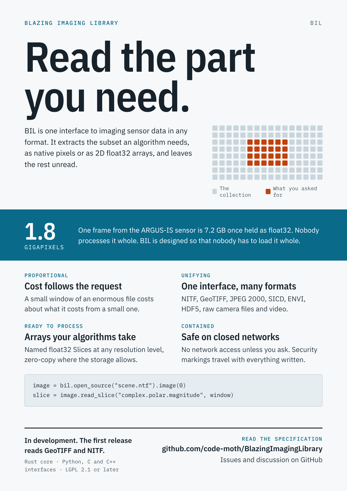
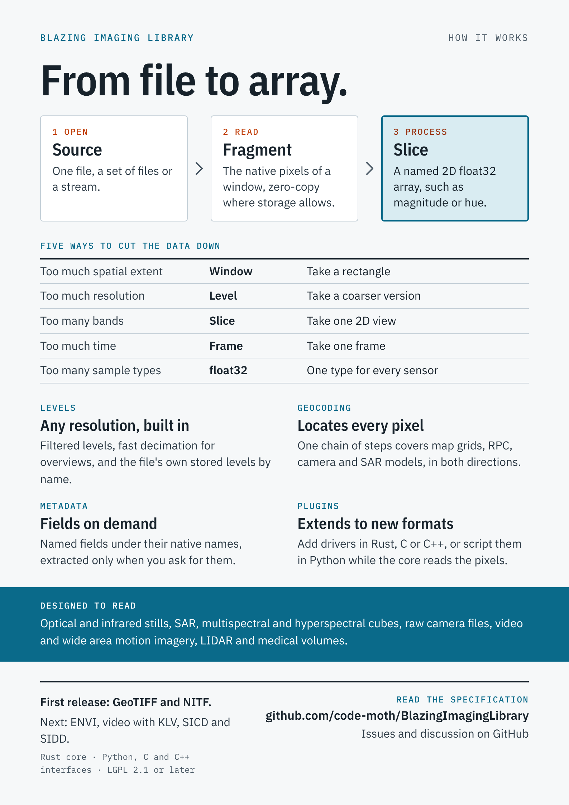

# Blazing Imaging Library (BIL)

**Read the part you need.**

BIL is one interface to imaging sensor data in any format. It extracts the subset an algorithm needs, as native pixels or as 2D float32 arrays, leaves the rest unread, and locates every pixel in the world.

BIL is written in Rust, with a C-callable interface over it delivered as one shared library, and a Python interface on the same core. It is licensed under the LGPL, version 2.1 or later, with a static-linking exception.

<p>
<a href="flyer.pdf"></a>
<a href="flyer.pdf"></a>
</p>

The two-page flyer is [`flyer.pdf`](flyer.pdf), with its source in [`flyer.html`](flyer.html).

> **Status: designed, not yet usable.** The [specification](docs/specification/specification.md) is at version 69, with two decisions left open: the libraries for the medical, security screening and sonar cases, and the full contents of the metadata dictionary and its domain profiles. The first experiments on BIL's core have passed. There is no usable library yet, and the code shown below is the specification's, not yet working. The first release, Tier 1, will read GeoTIFF and NITF.

## Why BIL is needed

**Sensor data outgrows memory, and always will.** A collection grows in rows, columns, bands, frames and bytes per sample at once, while memory grows along one axis. Algorithms want float32 or complex values, in several working copies, so the working form is larger than the stored one.

| Data | Held whole as float32 |
| --- | --- |
| One band, 100,000 × 100,000 pixels | 40 GB |
| Hyperspectral cube, 10,000 × 10,000 pixels × 200 bands | 80 GB |
| One hour of 3840 × 2160 video at 30 frames a second, luma only | About 3.6 TB |
| One frame from the ARGUS-IS wide area sensor: 1.8 gigapixels, 12 frames a second | 7.2 GB |

The sizes are plain arithmetic at 4 bytes a value. The ARGUS-IS figures are as reported in 2013. No one processes such data whole, and with BIL no one has to load it whole.

**Every format solves the subset problem differently,** through tiles, strips, chunks, key frames or pyramids, and some do not solve it at all. Without a common layer, each algorithm reimplements this for every format or gives up and loads everything. Today a developer whose algorithm takes imagery from several kinds of sensor assembles several libraries, then writes code for each format to cut subsets, convert samples and locate pixels. BIL is the single layer beneath such algorithms.

## How it works

**From file to array, in three steps.**

| Step | Concept | What it is |
| --- | --- | --- |
| Open | Source | One file, a set of files or a stream, holding one or more Images |
| Read | Fragment | The native pixels of a Window, unaltered, borrowed without a copy where the storage allows |
| Process | Slice | A named 2D float32 array, such as `complex.polar.magnitude` or `color.hsv.hue`, made in one pass |

**Five ways to cut the data down.** Each concept cuts along one dimension, and they stack.

| Too much | Concept | The cut |
| --- | --- | --- |
| Spatial extent | Window | Take a rectangle |
| Resolution | Level | Take a coarser version, filtered or decimated. A file's own reduced-resolution data is read as stored levels. |
| Bands or components | Slice | Take one 2D view |
| Time | Frame | Take one frame |
| Sample precision | float32 | One type for every sensor |

**Cost follows the request, not the collection.** A small Window of an enormous file costs about what it costs from a small one. Nothing is decoded until a region is asked for, data is borrowed rather than copied where it can be, every Slice and every Level a request names is made in one pass, and the memory a read needs is bounded and known in advance. A caller that works through a file in order says so, and BIL reads and decodes the next blocks ahead, in the order the file stores them.

**A Window gives the same answer as the whole.** A Slice of any Window equals the same region cut from the Slice of the whole Image, to a stated tolerance, so an algorithm can work through an image of any size in pieces.

## A taste of the interface

The calls below are the specification's, in Python, with one assumption from BIL by Example: how a `Window` is built. Rust and C have the same calls. None of this runs yet.

```python
import bil

source = bil.open_source("scene.ntf")
image  = source.image(0)
window = bil.Window(0, 0, 4096, 4096)   # row and column start, row and column count

magnitude = image.read_slice("complex.polar.magnitude", window)   # a 2D float32 Slice
overview  = image.read_slice("complex.polar.magnitude", window, level=3)
pyramid   = image.read_slice_levels("complex.polar.magnitude", window, 4)

array = magnitude.data       # a NumPy array over the same memory
magnitude.status             # Status.Complete, or Partial with the missing pixels marked

model = image.read_geo_model(image.list_geo_models()[0], 0)
chain = model.for_slice(overview)                      # covers the Window and the Level
where = chain.image_to_world([(0.0, 0.0)], bil.open_terrain("dted/"), accuracy=True)
bil.circular_error(where[0].accuracy, 0.9)            # CE90, from the full error record

photo = bil.open_source("photo.tif").image(0)          # another sensor, the same calls
rgb   = photo.read_slices("color.rgb", ["red", "green", "blue"], window)
```

[BIL by Example](docs/assessments/bil-by-example.md) has calls for every part of the specification and every kind of sensor, in Python, Rust and C.

## What BIL reads

The design covers every format below. They are built in tiers, each finished before the next starts.

| Tier | Formats | With them |
| --- | --- | --- |
| Tier 1 | GeoTIFF, uncompressed or Deflate; NITF, uncompressed or JPEG 2000 | Fragments, Slices, Levels, stored levels, the Fragment cache; affine and RPC geocoding; metadata on demand; markings; TIFF and GeoTIFF writing; Rust, Python and C |
| Tier 2 | ENVI; video with KLV metadata; SICD and SIDD | Readers for threads, scripted drivers in Python, and plugins in C, C++ or Rust |
| Tier 3 | The rest: HDF5, NetCDF, raw camera files, wide area motion imagery, LIDAR and depth cameras, medical volumes and whole-slide pathology, security screening, ultrasound and sonar | Each assessed case by case |

BIL reads medical data for research and processing. It is not for diagnostic use.

## The design in brief

**Seven rules every part follows.**

1. **Proportional:** the cost of a read follows the data it covers.
2. **Lazy:** nothing is decoded until a region is asked for.
3. **Faithful:** a Fragment delivers the native sample type and bit depth unaltered.
4. **Composable:** choosing an Image, a frame, a Window, a Level and a slice function are separate steps that stack.
5. **Transparent:** the original metadata is always reachable, under its native names.
6. **Contained:** BIL reaches the network only for a location the caller gave, and writes only where the caller named a place.
7. **Uniform:** every format and sensor passes through the same calls. A difference between sources is a reported property, never a special case.

**What else it does**

- **Geocoding as a chain.** Map grids, RPC, camera, SAR and per-frame video models are chains of the same steps, run in both directions, each tested against an established implementation. Every position can carry a full record of its accuracy, by source and by kind, carried through the chain.
- **Metadata on demand.** Fields under their native names, decoded only when read, and a dictionary of essential items that every format offers as far as it can. Domain profiles name the items each kind of work needs, such as SAR calibration or optical reflectance, whatever the sensor or format, and check a file against them before a pixel is read.
- **Built for untrusted files.** Resource limits, plugins only from configured places, fuzz testing of BIL's own readers, and drivers that can run in a separate process.
- **Markings travel.** Security markings are carried into everything BIL writes.
- **Extensible.** Drivers in Rust, C or C++, or scripted in Python while the compiled core reads the pixels.

**Not in BIL.** Registration, orthorectification and analysis are layers above it. BIL prepares the data they start from.

## Documents

| Document | What it is |
| --- | --- |
| [Specification](docs/specification/specification.md), version 69 | The source of truth for the design |
| [User Manual](docs/manual/user-manual.md), version 2 | How to use BIL, chapter by chapter, with what runs today and the gaps found while writing it |
| [BIL by Example](docs/assessments/bil-by-example.md), version 8 | Calls for every use case, in Python, Rust and C |
| [Implementability](docs/assessments/implementability.md), version 6 | Whether BIL can be built, where it may go wrong, what to try first, and what each change means for the code |
| [Red team, pass 1](docs/reviews/red-team-pass-1.md) and [pass 2](docs/reviews/red-team-pass-2.md) | Two adversarial reviews of the specification, every finding resolved |
| [Experiment 1](experiments/exp1-fused-loop/RESULTS.md) and [1b](experiments/exp1-fused-loop/RESULTS-1b.md) | The fused loop and the rolling buffer |

Each document has a rendered `.html` page beside its Markdown source.

## Experiments so far

**Experiment 1, the fused loop.** One pass makes a slice function's Slices at Levels 0 to 4. Over 2,400 random Windows and about 580 million values, no value differed in a single bit between a Window and the whole Image, or between scalar, AVX2 and AVX-512 code.

**Experiment 1b, the rolling buffer.** The same arithmetic, streamed through every Level on a ring of a few rows, into buffers the caller owns, with nothing allocated per read. The same tests pass with the same bits, as do every Window of 25 small Images, and the pass is 3 to 5 times faster than experiment 1 on the fastest instruction set. `pixel.raw` takes 1.7 times a memory copy at Level 0. `complex.polar` and `color.hsv` are limited by their arithmetic, and take 1.4 to 1.7 times that arithmetic alone at Level 0. Missing data follows section 5 of the specification, with both of its weightings, checked bitwise against an independent reference, and costs nothing where no pixel can be missing. Labels, range, the mask Slices and `decimate` are each checked against their definitions, and `binomial5`, the level method with less aliasing, agrees bitwise with an independent reference at 0.9 to 1.3 times the cost of `bilinear`.

```sh
cargo run --release --bin exp1b             # the full report, including speed
cargo run --release --bin exp1b -- --check  # correctness only, as CI runs it
cargo run --release --bin exp1 -- --check   # experiment 1's own check
```

CI runs the checks on Linux on x86 and ARM, Windows, and macOS on ARM, where the vector code is NEON.

## What is here

| Path | Contents |
| --- | --- |
| `flyer.pdf`, `flyer.html` | The two-page flyer, and the page it is printed from |
| `docs/` | The specification, the user manual, reviews and assessments, the flyer's page images, and the scripts that render them |
| `crates/bil/` | The `bil` crate: so far, the vector layer and kernels from experiment 1 |
| `crates/bil-sys/`, `python/` | The native bindings and Python packages: early releases that hold the names |
| `experiments/exp1-fused-loop/` | Experiments 1 and 1b |
| `testdata/` | The manifest of real test files, pinned by checksum, and the script that fetches them |
| `deny.toml`, `deny-tests.toml` | License and source checks for what ships, and for test-only code |
| `CLAUDE.md` | Working notes: the state of the work and the next step |

## How it is made

The specification's author leads the design and rules on every decision. Claude, Anthropic's AI model, writes BIL against the specification, and a separate checking agent reviews what it writes for style and for agreement with the specification.

## License

GNU Lesser General Public License, version 2.1 or, at your option, any later version, with a static-linking exception: a program may link BIL statically, as Rust programs normally do, without the duty to let its users relink it. Changes to BIL itself remain under the LGPL. See `LICENSE` and `LINKING-EXCEPTION.md`.

BIL's own packages contain only builds compatible with LGPL 2.1, with Apache-2.0 components accepted. LGPL 3 libraries are used only as test references or as optional plugins, and plugins under a stricter license are optional and packaged separately.
